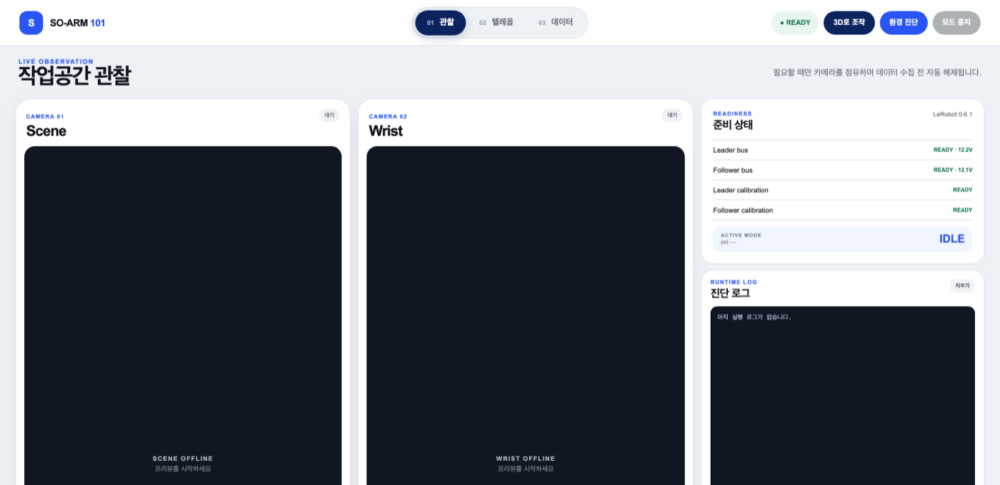
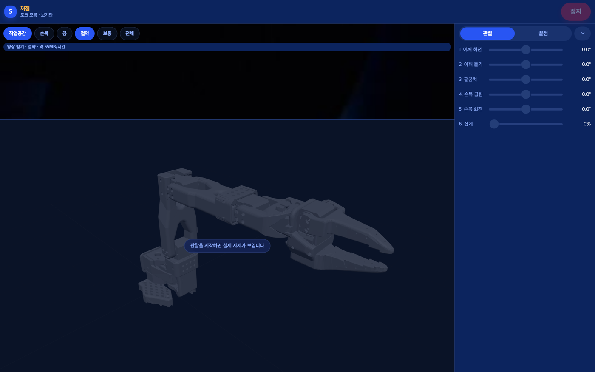
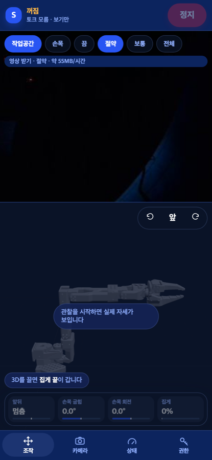

# SO-ARM101 Console

A personal project for controlling an SO-ARM101 robotic arm, viewing camera feeds, and collecting training demonstrations in a browser.
I also built a virtual leader mode that controls the physical arm by manipulating a 3D arm on a Mac or iPhone.

- **Type:** Personal robotics project
- **Main work:** Arm control · 3D virtual leader · Demonstration collection · Training server integration
- **Technologies:** Python · FastAPI · LeRobot · Feetech SDK · three.js



<sub>The console for observation, teleoperation, and data collection. No cameras were connected when this screenshot was taken.</sub>

## Overview

| Task | Description |
| --- | --- |
| Arm control | Physical leader–follower teleoperation or remote control through a 3D virtual leader |
| Demonstration collection | Camera video, joint positions, and servo values recorded as LeRobot datasets |
| Data review | Re-record, delete, and replay episodes; inspect quality and collection provenance |
| Training and policy execution | Transfer datasets to Spark, retrieve checkpoints, and run policies locally or remotely |

## Implementation

- **Control ownership:** Centralizes processes accessing the arms and cameras, along with remote control authority.
- **Demonstration recording:** Records video, joint positions, and servo values together, with per-episode quality and provenance information.
- **Motion limits:** Aligns starting poses and applies joint limits, target delta limits, and a watchdog.

See the [design notes](docs/design-notes.md) and [safety documentation](SAFETY.md) for detailed design and failure handling.

## Operator Views



<sub>A 3D viewer with joint and endpoint controls. This screenshot was taken before observation started, so camera feeds and actual joint values are absent.</sub>

<details>
<summary>iPhone view</summary>

<p align="center"></p>

The phone layout focuses on endpoint control and camera viewing. The stop button in the virtual leader interface stays visible when switching tabs.

</details>

## Getting Started

This is an experimental system configured for specific hardware. Before moving the physical arm, read [SAFETY.md](SAFETY.md) and [RUNBOOK.md](RUNBOOK.md), and arrange an on-site observer and a way to cut power.

```bash
git clone https://github.com/sesepark/soarm101-console.git
cd soarm101-console
uv sync --all-groups
cp config/soarm.env.example config/soarm.env
```

Set the leader, follower, and camera paths in `config/soarm.env`, then run diagnostics.

```bash
./scripts/doctor.sh
.venv/bin/pytest -q
```

Doctor only reads motor status and sends no motion commands.
Calibrate both arms before starting the console.

```bash
./scripts/calibrate_follower.sh
./scripts/calibrate_leader.sh
./scripts/run_web.sh
```

Open `http://127.0.0.1:8088`. Use an SSH tunnel for remote access.
Enabling motion requires `SOARM_ENABLE_MOTION=1`, a restart, and the on-site confirmation procedure for the selected mode.
The desktop console requires typing `START SOARM101`. Separate start/stop conditions for mobile physical teleoperation are documented in the [design notes](docs/design-notes.md#모바일-텔레옵).

## Documentation

The linked operational and design documents are in Korean.

| Document | Contents |
| --- | --- |
| [Runbook](RUNBOOK.md) | Calibration, teleoperation, collection, and recovery |
| [Datasets](DATASET.md) | Recorded fields, episode management, quality, and provenance |
| [Training integration](TRAINING.md) | Training server, data transfer, and checkpoints |
| [Design notes](docs/design-notes.md) | Ownership, starting poses, virtual leader, and remote inference |
| [Architecture](ARCHITECTURE.md) · [HUBq](docs/HUBq.md) | Hardware ownership and control authority |
| [Protocol](PROTOCOL.md) · [Design decisions](ADR/) | Observation/action protocol and key decisions |
| [Hardware](hardware.md) | USB/camera identification and device mapping |
| [Safety](SAFETY.md) · [Failure handling](FAILURE_MODES.md) | Guarantees and on-site response |

## Scope and Limitations

- This is not a safety-certified control system. A software stop cannot replace a physical E-stop or power cutoff.
- Device locks apply among this project's processes. They do not block access by external programs.
- The console API has no authentication. Bind it to a local address and restrict remote access to SSH tunnels.
- Spark's remote inference gRPC endpoint has no authentication and binds only to a tailnet address. Access control relies on Tailscale ACLs, and the endpoint runs only for the policy execution side lane's time limit.
- Device mappings and calibration reflect the current hardware. Datasets and checkpoints are excluded.
- With servo firmware 3.9, `Present_Current` reads only 0 or 1. The field is recorded but cannot be used as a current measurement.

## Related Projects

- [sparkq](https://github.com/sesepark/sparkq) — GPU job queue for the training server
- [xArm7 Teleop](https://github.com/sesepark/xarm7-pi0-teleop) — An xArm7 experimental workspace using GELLO and phone input

The robot runtime is based on [LeRobot](https://github.com/huggingface/lerobot) and its [SO-101 workflow](https://github.com/huggingface/lerobot/blob/main/docs/source/so101.mdx).
This project is not affiliated with or endorsed by Hugging Face.
