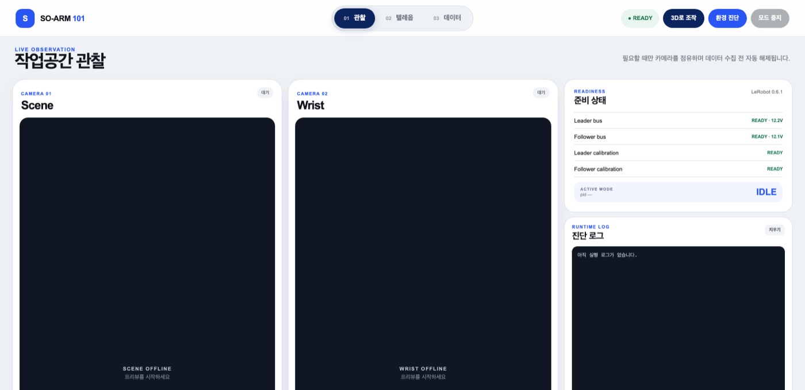
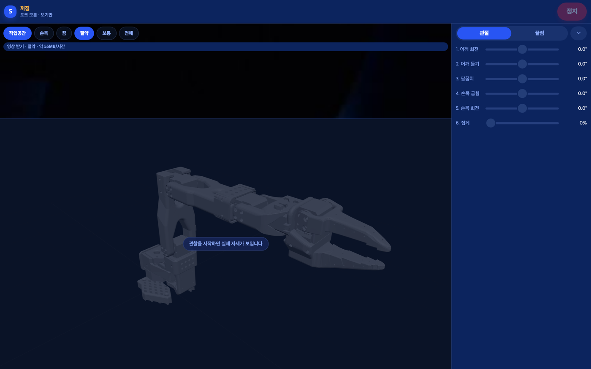
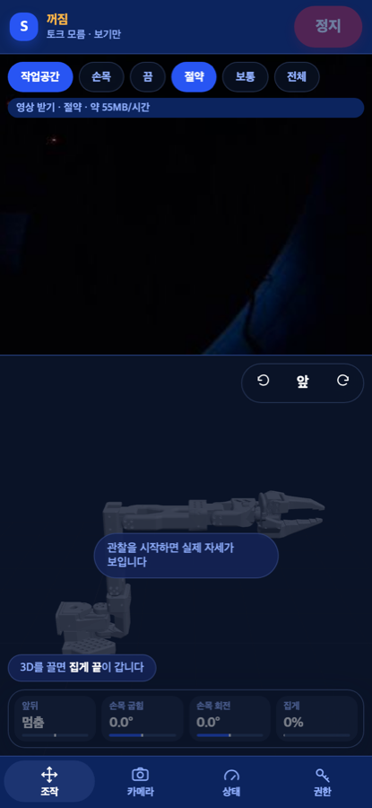

# SO-ARM101 Console

브라우저에서 SO-ARM101 로봇팔을 조작하고, 카메라를 확인하며, 학습용 시연을 수집하는 개인 프로젝트.
맥·아이폰의 3D 팔을 움직여 실제 팔을 제어하는 가상 리더 모드도 만들었다.

- **성격:** 개인 로봇 프로젝트
- **주요 작업:** 팔 제어 · 3D 가상 리더 · 시연 수집 · 학습 서버 연동
- **기술:** Python · FastAPI · LeRobot · Feetech SDK · three.js



<sub>관찰·텔레옵·데이터 수집을 관리하는 콘솔. 캡처는 카메라가 연결되지 않은 상태다.</sub>

## 프로젝트 개요

| 작업 | 내용 |
| --- | --- |
| 팔 조작 | 물리 리더–팔로워 텔레옵, 또는 3D 가상 리더로 원격 조작 |
| 시연 수집 | 카메라 영상과 관절·서보 값을 LeRobot 데이터셋으로 기록 |
| 데이터 확인 | 회차 재촬영·삭제·재생, 품질과 수집 출처 확인 |
| 학습·정책 실행 | Spark로 데이터셋 전송, 체크포인트 회수, 로컬·원격 정책 실행 |

## 구현 내용

- **제어권 관리:** 팔·카메라에 접근하는 프로세스와 원격 조작 권한을 한곳에서 관리한다.
- **시연 기록:** 영상·관절 위치와 서보 값을 함께 남기고, 회차별 품질·출처를 확인한다.
- **동작 제한:** 시작 자세를 맞추고 관절 한계·목표 변화량·워치독을 적용한다.

세부 설계와 장애 대응은 [설계 기록](docs/design-notes.md)과 [안전 문서](SAFETY.md)에 있다.

## 조작 화면



<sub>관절·끝점 조작을 제공하는 3D 뷰어. 캡처는 관찰을 시작하기 전 상태로, 카메라와 실제 관절값은 표시되지 않는다.</sub>

<details>
<summary>아이폰 화면 보기</summary>

<p align="center"></p>

폰에서는 끝점 조작과 카메라 확인을 중심으로 배치했다. 가상 리더 화면의 정지 버튼은 탭을 바꿔도 표시된다.

</details>

## 시작하기

이 장비에 맞춘 실험용 시스템이다. 실제 팔을 움직이기 전에 [SAFETY.md](SAFETY.md)와
[RUNBOOK.md](RUNBOOK.md)를 확인하고 현장 관찰자·전원 차단 수단을 준비한다.

```bash
git clone https://github.com/sesepark/soarm101-console.git
cd soarm101-console
uv sync --all-groups
cp config/soarm.env.example config/soarm.env
```

`config/soarm.env`에 리더·팔로워·카메라 경로를 설정한 뒤 진단한다.

```bash
./scripts/doctor.sh
.venv/bin/pytest -q
```

Doctor는 모터 상태만 읽으며 모션 명령을 보내지 않는다.
양팔 캘리브레이션을 마친 뒤 콘솔을 실행한다.

```bash
./scripts/calibrate_follower.sh
./scripts/calibrate_leader.sh
./scripts/run_web.sh
```

접속 주소는 `http://127.0.0.1:8088`이다. 원격 접속은 SSH 터널을 사용한다.
동작을 허용하려면 `SOARM_ENABLE_MOTION=1` 설정과 재시작이 필요하며, 모드별 현장 확인 절차를 거친다.
데스크톱 콘솔은 `START SOARM101` 입력을 요구한다. 모바일 물리 텔레옵의 별도 시작·정지 조건은
[설계 기록](docs/design-notes.md#모바일-텔레옵)에 있다.

## 문서

| 문서 | 내용 |
| --- | --- |
| [운용 절차](RUNBOOK.md) | 캘리브레이션, 텔레옵, 수집, 복구 |
| [데이터셋](DATASET.md) | 기록 항목, 회차 관리, 품질·출처 정보 |
| [학습 연동](TRAINING.md) | 학습 서버, 데이터 전송, 체크포인트 |
| [설계 기록](docs/design-notes.md) | 소유권, 시작 자세, 가상 리더, 원격 추론 |
| [시스템 구조](ARCHITECTURE.md) · [HUBq](docs/HUBq.md) | 하드웨어 소유권과 조작 권한 |
| [통신 규약](PROTOCOL.md) · [설계 결정](ADR/) | 관측·행동 규약과 주요 결정 |
| [하드웨어](hardware.md) | USB·카메라 식별과 장치 매핑 |
| [안전](SAFETY.md) · [장애 대응](FAILURE_MODES.md) | 보장 범위와 현장 대응 |

## 사용 범위와 한계

- 안전 인증을 받은 제어 시스템이 아니다. 소프트웨어 정지는 물리 E-stop이나 전원 차단을 대체하지 않는다.
- 장치 잠금은 이 프로젝트의 프로세스 사이에서 적용된다. 외부 프로그램의 장치 접근까지 막지는 않는다.
- 콘솔 API에는 인증이 없다. 로컬 주소에만 바인딩하고 원격 접속은 SSH 터널로 제한한다.
- Spark의 원격 추론 gRPC는 인증 없이 tailnet 주소에만 열린다. 접근 제어는 Tailscale ACL에 의존하며, 정책 실행 곁다리의 시한 동안만 동작한다.
- 장치 매핑과 캘리브레이션은 현재 장비 기준이다. 데이터셋과 체크포인트는 저장소에 포함하지 않는다.
- 서보 펌웨어 3.9의 `Present_Current`는 0·1로만 읽힌다. 기록 열은 있으나 전류 측정값으로 사용할 수 없다.

## 관련 프로젝트

- [sparkq](https://github.com/sesepark/sparkq) — 학습 서버의 GPU 작업 큐
- [xArm7 Teleop](https://github.com/sesepark/xarm7-pi0-teleop) — GELLO·휴대폰을 사용하는 xArm7 실험 환경

로봇 런타임은 [LeRobot](https://github.com/huggingface/lerobot)과
[SO-101 워크플로](https://github.com/huggingface/lerobot/blob/main/docs/source/so101.mdx)를 기반으로 한다.
Hugging Face와 제휴·보증 관계는 없다.
