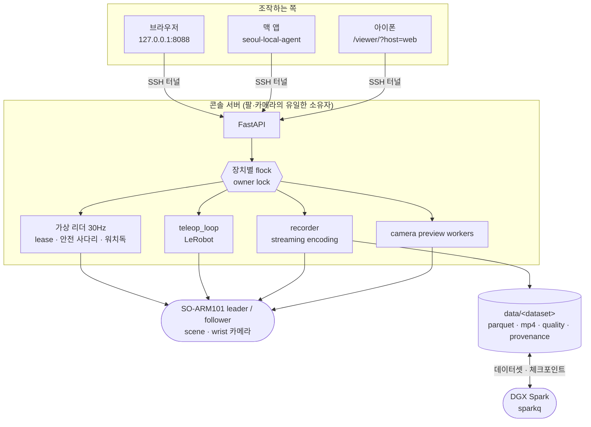

# SO-ARM101 설계와 동작 기록

[프로젝트 소개](../README.md) · [현장 운용 절차](../RUNBOOK.md)

## 모바일 텔레옵

모바일 `/viewer/?host=web`의 **텔레옵** 탭에서 물리 리더–팔로워 실행·정지와 로그를 확인할 수
있음. 권한 탭에 조작 토큰만 입력한 뒤(가상 리더 권한 받기는 불필요), 현장 확인과
체크만으로 시작함(문구 입력 없음). HUBq의 기존 장치 점유 검사와 hardware doctor를 그대로
사용하므로 맥북·가상 리더·수집·정책의 제어권을 자동으로 빼앗지 않음. 두 팔은 허브 서버에
연결되어 있어야 함. 폰 화면 잠금·앱 전환·페이지 종료 시 정지 요청을 보냄. 유실되더라도
마지막 폰 heartbeat 후 5초에 HUBq와 텔레옵 자식의 독립 watchdog이 정상 종료를 요청함.
콘솔 heartbeat는 모바일 세션을 연장하지 않으므로 허브 프로세스가 살아 있어도 고아 텔레옵이
계속되지 않음. 두 데몬이 내려가도 자식이 같은 durable deadline을 검사함. 재접속은 자동 재시작하지
않으며 새 현장 확인이 필요함. 웹앱 내부 탭 이동은 실행을 유지함. 속도·관절 제한은 기존 그대로이며
정지는 토크를 풀지 않음. 맥 앱의 native 뷰와 기존 데스크톱 텔레옵 수명은 유지함.


## 시스템 구조



콘솔은 기본적으로 `127.0.0.1`에만 bind함. 인증 없는 motion-control API를 LAN에 노출하지 않으며,
원격 접속은 SSH 터널을 씀 — **신뢰 경계는 그 터널이다.**

`/api/status`의 `capabilities`가 이 서버가 답할 수 있는 것들의 이름을 실음 — `abort`, `resume`,
`preview`, `quality`, `delete`, `train`, `replay_preview`, `soft_start`, `sensor_extras`. 맥 앱은
이 목록에 이름이 있을 때만 해당 기능을 켬. 화면이 서버보다 앞서 나가면 사람은 눌리지 않는 단추를
보게 되고, 서버가 앞서 나가면 새 기능이 아무에게도 보이지 않기 때문임.

## 설계에서 신경 쓴 부분

- **장치의 소유자는 언제나 하나임.** observation·teleop·recording·가상 리더 경로가 장치별
  `flock`으로 serial bus와 카메라를 배타 점유함. 같은 팔에 두 곳에서 명령이 들어가는 것이 이
  시스템에서 가장 나쁜 실패이기 때문임. lock을 무시하는 외부 프로세스까지 OS가 막아 주지는
  않으므로 그 한계도 함께 적어 둠. [ADR 0003](../ADR/0003-device-owner-lock.md)
- **게이트가 사고의 원인이 되고 있었음.** 예전에는 시작 전에 "토크가 걸려 있지 않은가"를
  물었는데, 텔레옵과 수집은 팔이 떨어지지 않도록 토크를 켠 채 끝나므로 **정상적으로 끝낸 세션
  다음의 시작이 반드시 거절되었음.** 사람은 그때마다 토크를 풀었고, 팔은 처졌고, 다음 시작에서
  그만큼 튀었음. 지금 시작을 막는 것은 모터가 답하지 않거나 전압이 범위 밖일 때뿐이고, "다른
  프로세스가 이미 팔을 쥐고 있는가"는 `flock`이 답함. 안전 장치가 사람에게 위험한 우회를 시키면
  그것은 안전 장치가 아니기 때문임(2026-09-05).
- **시작할 때 팔이 튀지 않게 함.** 두 자리를 고쳤음. 붙는 순간에는 토크가 켜지기 전에
  `Goal_Position`을 지금 자세로 옮김 — STS3215는 토크가 걸리는 순간 남아 있던 옛 목표를 향해
  최고 속도로 가기 때문임. 루프에 들어가기 전에는 팔로워를 리더의 **지금** 자세까지 s-curve로
  걸어감(첨두 40°/s, 집게 50%/s, 1–6초) — LeRobot의 첫 틱은 리더 자세를 그대로 보내므로 두 팔이
  다르면 팔로워가 그 차이만큼 한 번에 뛰기 때문임.
- **물리 리더가 없어도 조작할 수 있게 하되, 권한은 하나만 줌.** 3D로 그린 팔을 끌면 목표값이
  30Hz로 들어옴. 그 값은 절대 관절 한계 → 틱당 변화량 → 자세 동기화 → 부하·전류·추종오차·온도 →
  워치독 순서로 검사되고, 조작 권한(lease)은 한 시점에 한 기기만 가짐. 원격 조작에서 가장 흔한
  사고는 "누가 지금 이 팔을 움직이고 있는지 모르는 것"이기 때문임. [ADR 0002](../ADR/0002-virtual-leader-owner.md)

  

  <sub>맥·브라우저에서 여는 같은 화면. `관절`과 `끝점`(역기구학) 두 조작 방식이 있고, 오른쪽
  값은 서버가 되읽어 주는 실제 자세임. 권한을 받기 전에는 보기만 함.</sub>

- **폰에서는 화면을 줄이는 대신 조작 방식을 줄였음.** 관절 슬라이더 여섯 줄은 393×852 화면에서
  267px을 가져가 카메라를 92px짜리 띠로 눌렀음. 그래서 폰에서는 조작 방식이 `끝점` 하나이고 아래
  조작판이 없음. 사람이 직접 정하는 넷(앞뒤·손목 굽힘·손목 회전·집게)은 3D 위에 뜨는 타일 넷이
  맡고, 넷 다 누른 채 좌우로 끄는 같은 몸짓임. 그 결과 카메라는 294px(폭에 정확히 4:3이라
  640×480이 잘리지 않는다), 3D는 392px을 씀. **원격으로 팔을 움직이는 사람에게 가장 필요한 것은
  슬라이더가 아니라 팔이 무엇을 하는지 보이는 화면이기 때문임.**

  <table>
  <tr>
  <td width="34%"></td>
  <td width="66%" valign="top"><sub>카메라 294px · 3D 392px. 3D 위에 뜬 타일 넷(<b>앞뒤 · 손목
  굽힘 · 손목 회전 · 집게</b>)이 관절 슬라이더 여섯 줄을 대신하고, 넷 다 누른 채 좌우로 끄는 같은
  몸짓임. 아래 탭 넷(조작 · 카메라 · 상태 · 권한) 어디에서도 <b>정지</b>가 늘 보임. 위쪽
  <code>절약 · 약 55MB/시간</code>은 서버에 거는 카메라 프로필이라, 받는 쪽에서 프레임을 버리는
  것이 아니라 실제로 덜 찍고 덜 보냄.</sub></td>
  </tr>
  </table>

- **찍다 만 회를 온전한 시연인 척 남기지 않음.** 수집 조작은 넷임 — `right`(조기 종료),
  `left`(재촬영), `esc`(저장하고 끝), **`abort`(찍던 회를 버리고 끝)**. `esc`는 루프를 빠져나온 뒤
  `save_episode()`가 그대로 돌아 찍다 만 회를 저장하는데, 실제로 82프레임 2.7초짜리 조각이 남은
  적이 있어 `abort`를 따로 두었음. 회 사이에 누른 키를 버리는 이유와 그때 잃은 여덟 회 이야기는
  [DATASET.md](../DATASET.md)에 있음.
- **화면이 침묵하지 않게 함.** 회차 사이 정리와 저장(인코딩) 구간이 각각
  `phase=resetting`·`saving`으로 나가고, 저장된 회차 수는 `episodes_saved`로 실림. 정리 15초 뒤
  인코딩 8초 동안 화면이 아무 말도 하지 않아 사람이 수집이 죽은 줄 알던 자리이기 때문임. 수집
  중에는 카메라를 record 자식이 쥐고 있으므로 찍는 쪽이 보는 프레임을 5Hz로
  `/api/recording/preview/{scene|wrist}.jpg`에 내려놓되, **3초보다 오래된 그림은 404임** — 멈춘
  카메라의 마지막 장면을 계속 보여 주면 화면은 아무 일도 없다는 듯 그것을 보여 주기 때문임.
- **서보가 내주는 값을 전부, 원본 그대로 남김.** 수집이 매 프레임(30Hz) 위치 말고도
  부하·속도·온도·전압·상태 바이트·이동 플래그·전류와, 그 프레임을 읽은 시각, 카메라별 새 프레임
  여부, 그리고 **그 프레임의 서보 읽기가 실제로 성공했는지**를 별도 열로 남김. 어떤 열에도
  clamp·대체·보간이 없음 — 목적이 나중에 모터 부하로 간접 촉각을 추정하는 것이고, 시연은 다시
  찍을 수 없기 때문임. `observation.state`는 관절 위치 여섯 그대로 두므로 지금까지 학습한 정책과
  사전학습 정규화 통계는 그대로임. [DATASET.md](../DATASET.md)
- **학습은 콘솔이 띄우되 품지 않음.** `POST /api/spark/train`이 원격 tmux 세션 `train-<run>` 안에서
  `lerobot-train`을 시작하므로, 콘솔이 재시작돼도 학습은 그대로 돎. 실행 이름에 시각이 들어가는
  이유는 LeRobot이 `output_dir`이 이미 있으면 거절하기 때문임 — 고정 이름이던 때는 같은
  데이터셋의 두 번째 학습이 반드시 실패했고, 그 실패가 tmux 안에만 남았음. [TRAINING.md](../TRAINING.md)
  다만 **학습을 거는 정상 경로는 Spark 위의 sparkq 큐 하나이고**(맥 앱의 학습 버튼도 그리로 감),
  이 엔드포인트는 사람이 `curl`로 여는 문으로 남아 있되 큐의 대기열을 건너뜀 — GPU가 하나라
  문이 둘이면 서로를 보지 못하기 때문임.
- **큰 정책은 Spark에서 추론함.** `POST /api/policy/start`에 `remote: true`를 주면 콘솔이 sparkq의
  `soarm-policy` 곁다리를 켜고 준비를 기다린 뒤, Spark의 tailnet 주소 `:8091`에 LeRobot
  `RobotClient`를 **터널 없이 바로** 붙임 — SSH 터널은 보내는 크기와 거의 무관하게 왕복마다
  ~47ms를 더해 30Hz 제어 예산(33.3ms)을 맞출 수 없었음(2026-09-08 실측: 터널 62ms → 직결 22ms). 팔·카메라·12° 스텝 상한·정렬·토크·중지는 HUB가 계속 소유하고 가중치와
  계산만 Spark에 남음. 시행마다 곁다리 시한을 300초 연장하며, 명시 중지·오류 때는 곁다리를
  내려 얼린 학습을 즉시 깨움. 터널이나 서버가 끊기면 받은 액션 큐를 비우고 그 자리에서 멈추며,
  안전 자세 복귀도 새 자율 동작이므로 장애 때는 시도하지 않음. 서버가 끊기는 경우는 같음 —
  터널이 없어졌을 뿐 끊김을 다루는 자리는 그대로임.
- **지우는 것은 옮기는 것임.** `DELETE /api/datasets/{name}`은 `data/.trash/`로 **옮기기만** 함.
  회차 하나는 `DELETE /api/datasets/{name}/episodes/{index}`가 `lerobot-edit-dataset`으로 들어냄.
  과제가 다른 데이터셋에 이어 찍기는 400으로 거절함 — 데이터셋 하나는 학습 한 번의 단위이고,
  섞인 데이터는 파케이를 열기 전에는 섞였다는 사실조차 보이지 않기 때문임.
- **끊길 때 토크를 끄지 않음.** 팔이 떨어지는 고장이 팔이 버티는 고장보다 나쁘기 때문임. 대신
  손으로 옮기거나 보관 자세로 내릴 때 풀 수 있는 자리를 하나만 둠 — `POST /api/torque/release`가
  모션 토큰과 `RELEASE TORQUE SOARM101`을 요구하고, 모드가 도는 동안에는 거절함.

## 운영 흐름

| 순서 | 작업 | 보호 장치 |
| --- | --- | --- |
| 1 | **환경 진단** 실행 | 읽기 전용이며 teleop/record 중에는 실행을 막음 |
| 2 | calibration 파일 확인 | Leader/Follower 모두 유효한 motor ID와 range 필요 |
| 3 | **텔레옵 시작** | Motion flag, 현장 확인, 확인 문구 입력. 팔로워가 리더 자세까지 걸어간 뒤 루프 시작 |
| 4 | 현재 모드 중지 | 다음 모드가 시작되기 전에 owner lock 해제 |
| 5 | demonstration 기록 | camera role 확인을 추가로 요구. 실패한 회차는 `abort`로 버림 |
| 6 | 데이터셋 정리 | 지우기는 `data/.trash`로 옮기기만 하고, 수집·재생 중에는 거절 |
| 7 | 학습 시작 | 원격 tmux 세션에서 돌고, GPU가 하나라 동시 실행은 409 |

## 저장소 구조

```text
src/soarm_console/        FastAPI app, teleop, recording, replay, policy, diagnostics, camera workers
  owner_lock.py             장치별 flock — 한 시점에 한 소유자
  follower_start.py         붙는 순간과 루프 직전의 부드러운 시작(s-curve)
  sensors.py                서보 블록 판독(주소 56~70) 한 번에, 부호-크기 해석
  spark.py                  학습 서버 전송 · 원격 tmux 학습 · 모델 회수 · 원격 추론 곁다리
  models.py                 models/ 명세 · 카메라 대응 · 실행 가능성 · 삭제
  policy_manager.py         정책 서브프로세스 · SIGTERM · 상태와 로그
  policying.py              로컬 rollout · 원격 RobotClient · 연결 장애 즉시 정지
  static/                   데스크톱 콘솔 페이지
  static/viewer/            3D 조작 화면(맥·폰 공용). three.js r160 자체 호스팅, URDF 로더 직접 작성
src/hubq/                 독립 소유권·스케줄링 프로세스(1단계: 읽기 전용 락 원장)
scripts/                  calibration, doctor, web, teleoperation, recording, service installation
config/                   로컬 runtime 설정 template (커밋하지 않음)
models/                   회수한 pretrained_model과 soarm_model.json (커밋하지 않음)
deploy/                   systemd user service, udev rule
tests/                    hardware-free 테스트 300개 이상
ADR/                      Architecture Decision Records
```
